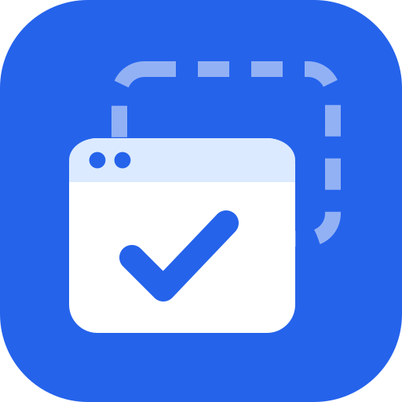

<p align="center"></p>

# Tab Dupes Begone

Click a GitHub link in Slack five times, get five identical GitHub tabs. Not anymore.

**Tab Dupes Begone** is a Chrome extension that notices when you're about to open a URL you
already have open in another tab, and switches you to that tab instead. You choose which kinds of
links and actions it applies to; by default that's links from desktop apps and installed web apps,
and links that open in a new tab.

## What switches

Each trigger has its own toggle in the extension's toolbar popup:

| Toggle | Covers | Default |
|---|---|---|
| Links from desktop apps & installed web apps | Slack, Mail, Teams, Zoom, …, and installed web apps (PWAs) | On |
| Links that open in a new tab | Plain click on a `target=_blank` link, or a click that makes the page open a tab right away | On |
| Cmd/Ctrl-click, middle-click, "Open link in new tab" | Also Shift-click (new window) | Off |
| Regular links that open in the same tab | Switches to the open tab and leaves the current tab where it was | Off |
| Typing a URL into a new tab | Typing a URL, or picking an omnibox suggestion, in a fresh new tab | Off |

If the URL isn't already open, everything opens normally.

These never switch, whatever the toggles say:

- Right-click a tab → **Duplicate**
- Reopening a closed tab (Cmd/Ctrl-Shift-T)
- A page opening a tab by itself, without a click just before (`window.open` from a timer, etc.)
- Typing a URL into a tab already showing a page — Chrome's own "Switch to tab" suggestion covers
  that
- Alt/Option-click and `download` links, links within the same page (`#section`), and links that
  only navigate an iframe

Matching is an **exact URL match**: `github.com/foo` and `github.com/foo#readme` are different
pages. Only tabs in normal browser windows are matched, and incognito and regular tabs are never
matched with each other.

## Install

- **Chrome Web Store:** _coming soon_
- **From source:** see [Development](#development), then load `dist/` via
  `chrome://extensions` → Developer mode → **Load unpacked**.

Requires Chrome 121 or newer.

### About the "Read and change all your data on all websites" warning

Chrome shows this because the extension runs a small content script on every page. It needs that
to tell what kind of link you clicked — which link, its target, the mouse button and modifier keys
— and, when a toggle is on and the URL is already open, to stop the click and switch tabs instead.
Without it, a duplicate tab would already be opening before the extension could react.

The script does not read page content, form fields, or keystrokes, and nothing it sees leaves your
device. It's short enough to read in a minute: [`src/content.ts`](src/content.ts). A welcome page
explains this on install.

## How it works

There are four paths, each gated on its toggle.

- **Click-time interception (content script).** On `pointerdown` over a link, the content script
  asks the background whether the coming click should switch: the click is classified (new-tab
  link, modified click, or same-tab link), the toggle checked, and open tabs searched for the exact
  URL. If so, the `click` is cancelled before the page or Chrome acts on it, and the existing tab
  is focused. If that tab has gone away in the meantime, the script performs the original
  navigation itself, so a click is never lost.
- **Fallback correlation (background).** Every click that wasn't intercepted is recorded per tab.
  When a page spawns a new tab (`webNavigation.onCreatedNavigationTarget`) within a second of a
  click, or after "Open link in new tab" on the same link from the context menu, the new tab is
  attributed to that click. It's closed if its URL is already open — checked again when it
  commits, so redirect links (like Gmail's) are matched on their final URL. This also covers
  keyboard activation and `window.open` called from a click handler.
- **Typed URL in a new tab.** A tab that starts on the new tab page and then commits a `typed` or
  `generated` navigation (from the omnibox) is closed if that URL is already open.
- **Desktop apps.** Chrome doesn't say *which app* opened a link, so the extension infers it:
  - *Native apps:* the OS hands the URL to Chrome, and the tab's first navigation has the
    transition type `start_page`. The only other source of that is Chrome's own "open these pages
    on startup" setting, where there's nothing open yet to match.
  - *PWAs:* the new tab is spawned by a tab that lives in an `app` window rather than a normal
    browser window.

  For native-app links the extension switches focus as soon as the tab is created and closes the
  new tab once Chrome confirms the `start_page` transition, so you barely see it. If the
  confirmation never comes, the new tab is left open in the background — nothing you wanted is
  closed.

The design is in [`docs/design.md`](docs/design.md); the per-trigger toggles are specified in
[`docs/superpowers/specs/2026-10-18-per-trigger-toggles-design.md`](docs/superpowers/specs/2026-10-18-per-trigger-toggles-design.md).

### Limitations

- Tested on Chrome for macOS. Windows and Linux should behave the same but are not yet verified —
  reports welcome.
- Other Chromium browsers (Edge, Brave, Arc) may label navigations differently.
- Pages that were open before the extension was installed, updated or re-enabled get the content
  script injected automatically; pages Chrome doesn't allow extensions on (the Web Store, `chrome://`)
  get none.
- Keyboard-activated links (Enter) aren't intercepted at click time. New-tab links still go
  through the fallback; same-tab links navigate normally.

## Privacy

The extension makes no network requests and collects nothing. It reads tab URLs and link clicks
locally only to compare URLs. Your five toggles are stored in `chrome.storage.sync` (synced by
Chrome to your other browsers if you use Chrome sync); short-lived per-tab bookkeeping lives in
session storage and is cleared when the browser closes. See [PRIVACY.md](PRIVACY.md).

## Development

```sh
yarn install
yarn build       # compile to dist/
yarn test        # unit tests (vitest)
yarn typecheck
yarn package     # build + zip to release/ for the Chrome Web Store
```

After rebuilding, click reload on the extension card in `chrome://extensions`. The service worker
console (the "service worker" link on that card) shows debug output.

### Project layout

```
src/settings.ts    Settings type, defaults, load/save (chrome.storage.sync)
src/messages.d.ts  message types shared by the content script and background (ambient)
src/decide.ts      pure decision functions (unit tested)
src/pending.ts     per-tab bookkeeping and last-click records in chrome.storage.session
src/background.ts  wires Chrome events and content-script messages to the decisions
src/content.ts     click observer injected into pages (classic script: no import/export)
src/toggles.ts     renders the five toggles (shared by popup and welcome page)
src/popup.ts       toolbar popup
src/welcome.ts     welcome page shown on install
public/            manifest, icons, popup/welcome HTML and CSS, copied into dist/
assets/            icon source and store assets (scripts/render-store-assets.sh)
scripts/           build helpers
```

### Manual test checklist

Start from the default toggles, with `https://github.com/` open in a tab. "Switches" means focus
moves to that tab and no extra tab remains; "opens normally" means you get a new tab or
navigation as usual. After changing a toggle, the popup applies it immediately.

**Links from desktop apps & installed web apps**
- [ ] On: `open "https://github.com/"` (macOS) → switches
- [ ] On: link to the same URL from a PWA → switches
- [ ] On: `open "https://github.com/explore"` (not open yet) → opens normally
- [ ] Off: both of the first two → open normally

**Links that open in a new tab**
- [ ] On: plain click on a `target=_blank` link to `https://github.com/` → switches
- [ ] On: a button whose click handler calls `window.open("https://github.com/")` → switches
- [ ] On: a Gmail-style redirect link (`target=_blank` to
  `https://httpbin.org/redirect-to?url=https://github.com/`, or a link in a Gmail message) → the
  new tab opens, redirects, then closes and switches
- [ ] On: Tab to a `target=_blank` link, press Enter → switches
- [ ] Off: all of the above → open normally

**Cmd/Ctrl-click, middle-click, "Open link in new tab"**
- [ ] Off (default): Cmd/Ctrl-click, middle-click, right-click → Open link in new tab → open normally
- [ ] On: each of those, plus Shift-click → switches

**Regular links that open in the same tab**
- [ ] Off (default): plain click on a same-tab link to `https://github.com/` → navigates normally
- [ ] On: same → switches; the tab you clicked in stays on its page
- [ ] On: link to the current page with a different `#hash` → scrolls normally

**Typing a URL into a new tab**
- [ ] Off (default): new tab, type `https://github.com/` → stays
- [ ] On: same → switches and the new tab closes
- [ ] On: type the URL into a tab already showing another page → navigates normally

**Never switch** (turn all toggles on)
- [ ] Right-click a tab → Duplicate → duplicate stays
- [ ] Close a tab, Cmd/Ctrl-Shift-T → reopens normally
- [ ] `window.open("https://github.com/")` in the DevTools console, without clicking the page
  first → new tab stays
- [ ] Alt/Option-click a link → downloads as usual
- [ ] Extension allowed in incognito, `https://github.com/` open only in an incognito window: a
  `target=_blank` link to it in a regular window → opens normally

## Contributing

Issues and pull requests are welcome — see [CONTRIBUTING.md](CONTRIBUTING.md).

## License

[MIT](LICENSE)
